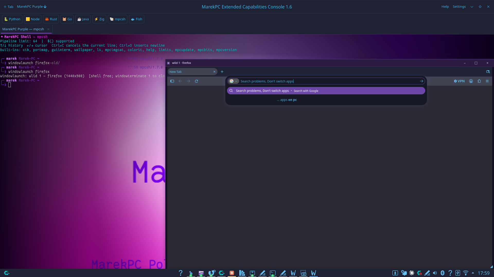

## Purplecode in action



# MPCSH — MarekPC Shell 1.7

Open-source shell + terminal console for MarekPC (Polska 2026).

## Components

| Binary | Source | Role |
|--------|--------|------|
| **mpcsh** | `mpcsh.c` | Interactive shell (fish-style grammar, pipelines, `$()`, GUI prompts, built-ins) |
| **mpcecc** | `mpcecc.c` | MarekPC Extended Capabilities Console — GTK4 + VTE host with profiles, wallpaper, tabs, and **PixelWindows** |

## What's new in 1.7 (`shell17`)

- **Multi-window PixelWindows** — each `windowlaunch` gets a `wlid`; several apps can live in the same tab as independent overlays.
- **Ctrl+Shift+Tab** cycles focused PixelWindows (Shift reverses). WM/DE cannot steal this the way Alt+Tab is stolen. F3 opens the star-map picker.
- **Krita / GIMP friendly sizing** — default framebuffer **1440×900**, in-tab frame cap **1920×1200**, aspect-correct **CONTAIN** fit (letterbox, never stretch or crop chrome).
- Firefox still uses isolated profile `MPCECCWLPROFILE` only.
- Crash dialog with Restart Shell / Close Tab; capture-phase clipboard & shortcuts.

## Build

```bash
# Shell
gcc mpcsh.c -o mpcsh $(pkg-config --cflags --libs gtk4) -lcurl
# optional wallpaper banner:
# gcc mpcsh.c -o mpcsh $(pkg-config --cflags --libs gtk4 gdk-pixbuf-2.0) -lcurl

# Console (needs VTE GTK4 + X11 helpers for PixelWindows)
gcc mpcecc.c -o mpcecc $(pkg-config --cflags --libs gtk4 vte-2.91-gtk4) -lX11 -lXtst -ldl -lm
```

PixelWindow tools expected on `PATH`: `Xvfb`, `xdpyinfo`, `import` (ImageMagick), `xdotool`.

## Quick use

```bash
# 1. Start the console
./mpcecc

# 2. Inside a tab (mpcsh):
windowlaunch krita
windowlaunch --size 1920x1080 firefox
wlidlist
windowterminate 1

# Cycle windows: Ctrl+Shift+Tab
# Star map: F3
```

## Config

- Shell: `~/.config/mpcsh/mpcsh.config` (`accent=`, `connector=`, `animated=`, …)
- Console profiles: `~/.config/mpcecc/profiles.conf`

## License / origin

MarekPC Polska 2026 · Open-source · https://github.com/eggyr25-lgtm/MPCSH
